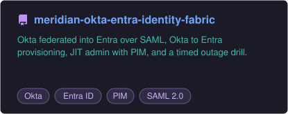
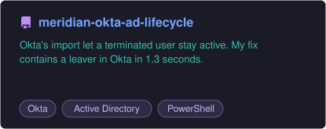
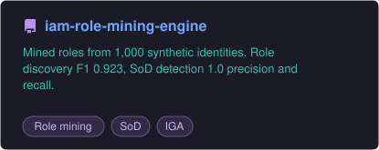
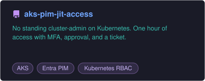
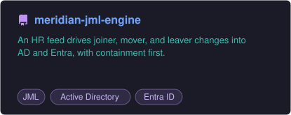
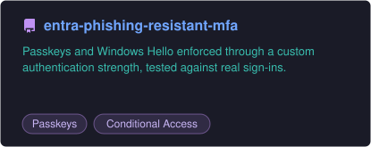
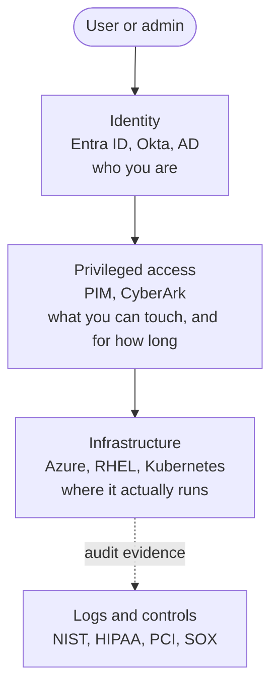

---

## About me

I'm an identity and privileged access engineer in Chicago, starting as a **PAM Forensic Analyst** in November 2026 and building toward CyberArk PAM engineering.

I came to identity through audit. At Giesecke+Devrient I tested logical access controls for PCI-DSS and ISO 27001. At LOG(N) Pacific I worked IAM and PAM engagements on the other side of that table. So I build the way an auditor would check: every control I set up comes with the evidence that proves it works, and every failure gets written down.

This profile is where that work lives. Everything here runs in a real Entra tenant, a real Okta org, and real Active Directory domain controllers.

---

## Start here

### [Meridian Identity Fabric: Okta + Entra ID Federation with JIT Privileged Access](https://github.com/ZayLinux26/meridian-okta-entra-identity-fabric)

My capstone. Active Directory owns the person, Okta signs them in, and Entra trusts Okta over SAML 2.0. Admin rights in Entra come only from a time-boxed PIM activation with a ticket number.

- **One AD disable cuts someone off everywhere.** Okta deactivated the user, and Entra disabled the account about 10 seconds later.
- **Okta's MFA unlocks Entra admin roles.** A federated user activated a PIM role with a phishing-resistant passkey from Okta.
- **I took Okta down on purpose.** Federated users were locked out, both cloud-only admin paths still worked, and recovery took 10 minutes.
- **13 things broke along the way,** and the README documents every one. The hardest needed an Okta inline hook I wrote and ran on Cloudflare Workers.

---

## Featured work

| Project | What it proves |
|---|---|
| [**meridian-okta-entra-identity-fabric**](https://github.com/ZayLinux26/meridian-okta-entra-identity-fabric) | Okta federated into Entra over SAML, Okta to Entra provisioning, JIT admin with PIM, and a timed outage drill |
| [**meridian-okta-ad-lifecycle**](https://github.com/ZayLinux26/meridian-okta-ad-lifecycle) | Okta's import let a terminated user stay active. My fix contains a leaver in Okta in 1.3 seconds. |
| [**iam-role-mining-engine**](https://github.com/ZayLinux26/iam-role-mining-engine) | Mined roles from 1,000 synthetic identities. Role discovery F1 0.923, SoD detection 1.0 precision and recall. |
| [**aks-pim-jit-access**](https://github.com/ZayLinux26/aks-pim-jit-access) | No standing cluster-admin on Kubernetes. One hour of access with MFA, approval, and a ticket. |
| [**meridian-jml-engine**](https://github.com/ZayLinux26/meridian-jml-engine) | An HR feed drives joiner, mover, and leaver changes into AD and Entra, with containment first |
| [**entra-phishing-resistant-mfa**](https://github.com/ZayLinux26/entra-phishing-resistant-mfa) | Passkeys and Windows Hello enforced through a custom authentication strength, tested against real sign-ins |

---

## Field notes

Things I found by building, that the vendor docs don't put up front.

| What I found | Where |
|---|---|
| Okta's scheduled AD import never sees a leaver who was moved out of its OU scope. The console only catches up when someone looks the user up. | [okta-ad-lifecycle](https://github.com/ZayLinux26/meridian-okta-ad-lifecycle#finding-1-the-leaver-gap) |
| With delegated auth on, Okta can let a user sign in for up to five days while every AD agent is down. AD isn't asked at all. | [okta-ad-lifecycle](https://github.com/ZayLinux26/meridian-okta-ad-lifecycle#finding-2-the-agent-outage-and-the-credential-cache) |
| Over SAML 2.0, Entra ignores an MFA claim sent as an attribute. It only reads `AuthnContextClassRef`, and Okta's UI can't set Microsoft's value there. | [okta-entra-identity-fabric](https://github.com/ZayLinux26/meridian-okta-entra-identity-fabric#7-what-broke-and-how-i-fixed-it) |
| Okta's Microsoft 365 connector writes as a directory sync engine, so flipping a user to cloud-managed in Entra blocks Okta from updating them. | [okta-entra-identity-fabric](https://github.com/ZayLinux26/meridian-okta-entra-identity-fabric#7-what-broke-and-how-i-fixed-it) |
| Disabling a user doesn't remove their PIM eligibility. The entitlement just sits there until someone reviews it. | [okta-entra-identity-fabric](https://github.com/ZayLinux26/meridian-okta-entra-identity-fabric#8-findings) |
| A Global Administrator can still show "Unauthorized" on an Azure subscription. Entra roles and Azure RBAC are separate planes. | [Azure custom RBAC](https://github.com/ZayLinux26/iam-analyst-portfolio#shipped-work) |

---

## Skills

**Proven in my public repos**

**Studying now**

**Controls I map every project to**

---

## Certifications

**Earned**

**Next, in order**

---

## Why identity, PAM, and Linux

Identity is the perimeter. PAM is the safe inside. Linux is the floor the safe sits on. If you can't operate all three together, you can't actually secure the enterprise.

---

## Right now

| | |
|---|---|
| **Starting** | PAM Forensic Analyst, November 2026 |
| **Studying** | CyberArk Defender, then Sentry, both by the end of 2026 |
| **Building** | A SOX and PCI-DSS identity engagement, and Project 10: access reviews scored against a seeded anomaly manifest |
| **Next** | Identity governance for AI agents: an agent registry, delegated OAuth, and auto-revoke when an agent drifts out of policy |

---

## GitHub activity

---

## Let's talk

Hiring for identity or privileged access? Working through an Okta, Entra, or PAM problem? Or just following along? I'd like to hear from you.

**Open to:** remote IAM and PAM engineering roles and contracts, identity governance, and roles that sponsor a security clearance.

If something here helped you, star the repo. It helps other people find it too.

